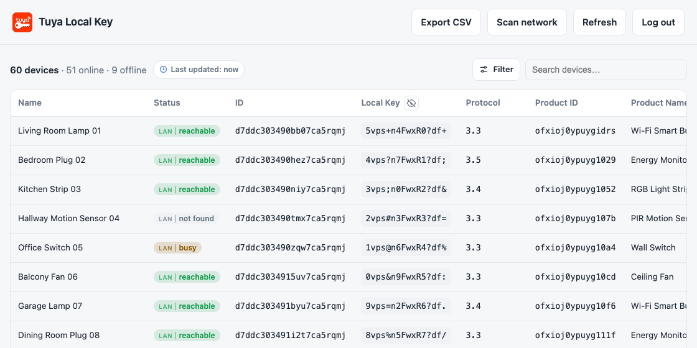

[](https://github.com/Muhammadusamataj/MYlocal-devices-tuya/actions/workflows/docker-publish.yml)
[](https://github.com/Muhammadusamataj/MYlocal-devices-tuya/pkgs/container/mylocal-devices-tuya)

# MY Local Devices Tuya

<picture>
  <source media="(prefers-color-scheme: dark)" srcset="docs/screenshots/header-devices-dark.png">
  <source media="(prefers-color-scheme: light)" srcset="docs/screenshots/header-devices-light.png">
  
</picture>

A fork of **Tuya Local Key** with a devices-first local control screen. Log in once with your Smart Life user code; local keys, IP addresses and protocol versions are remembered so daily ON/OFF control works without the cloud.

> HACS is not required for this app. It is a **Home Assistant add-on** (a small web server), not a HACS custom integration. Install it from the Supervisor add-on store using this repository URL.

## Features

- Devices screen first: big ON/OFF switches, live readings, search, and collapsed advanced DPs.
- LAN connections are saved in `lan-profile.json`; after setup the app reuses them and silently reconnects if the network changes.
- QR login fetches local keys; manual device add is also available from Settings.
- Local status/commands reuse encrypted caches and make no cloud request.
- Home Assistant ingress support, so Tailscale / WireGuard add-ons can provide secure remote access without router port forwarding.
- Optional Windows EXE and fully offline Android APK builds are included in the repo.
- Original key-finding features: device list, filters, CSV export, network scan, change detection, and support reports.

## Home Assistant add-on (recommended)

1. Make sure this repository is **public**.
2. In Home Assistant go to **Settings → Add-ons → App store → ⋮ → Repositories** and add:

   ```text
   https://github.com/Muhammadusamataj/MYlocal-devices-tuya
   ```

3. Install **MY Local Devices Tuya**, start it, and open it from the sidebar. It opens directly on the **Devices** screen.
4. If keys are not loaded yet, open **Settings → Setup / Smart Life login** in the drawer.
5. For remote access, install the **Tailscale** (or WireGuard) add-on in Home Assistant and open this add-on from the HA sidebar. Ingress handles authentication; the VPN handle encryption. No router setup is needed.

[](https://my.home-assistant.io/redirect/supervisor_add_addon_repository/?repository_url=https%3A%2F%2Fgithub.com%2FMuhammadusamataj%2FMYlocal-devices-tuya)

The GitHub Actions workflow publishes the multi-arch image to:

```text
ghcr.io/muhammadusamataj/mylocal-devices-tuya:latest
```

After the first workflow run, make the GHCR package **public** so Home Assistant can pull it.

## Docker

```bash
docker run -d --name mylocal-devices-tuya \
  -p 8000:8000 \
  -v mylocal-session:/data \
  ghcr.io/muhammadusamataj/mylocal-devices-tuya:latest
```

Open <http://localhost:8000/local>. For access beyond localhost set both `AUTH_USERNAME` and `AUTH_PASSWORD`; see [configuration](docs/configuration.md#security).

## Local builds

```bash
# Windows EXE -> dist/TuyaLocalKey.exe
python build_exe.py

# Offline Android APK -> dist/TuyaLocalKey-Offline.apk
python build_offline_apk.py --install
```

## Documentation

- [Installation](docs/installation.md)
- [Using the app](docs/usage.md)
- [Configuration and remote access](docs/configuration.md)
- [Network scanning](docs/network-scanning.md)
- [Troubleshooting](docs/troubleshooting.md)

## Credits and license

Based on [Tuya Local Key](https://github.com/vineetchoudhary/tuya-local-key) by Vineet Choudhary. Licensed under the [Apache License, Version 2.0](LICENSE); see [NOTICE](NOTICE) for attribution.
